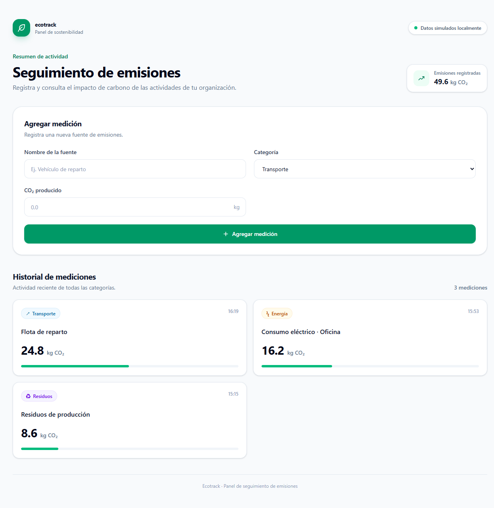
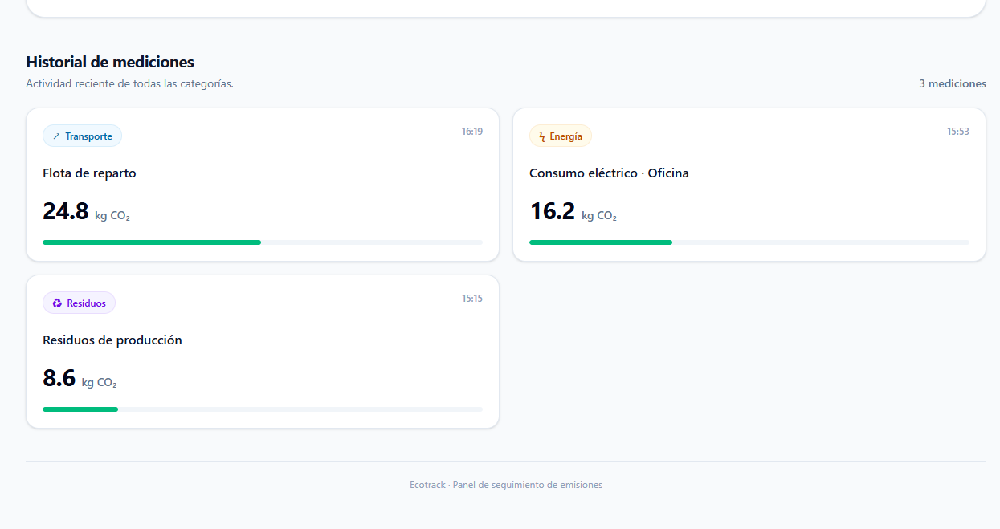

# Ecotrack Dashboard

Panel frontend para registrar y consultar emisiones de CO₂ por fuente y categoría. La interfaz incluye un formulario de mediciones, un total acumulado y una grilla con el historial.

## Capturas

AQUI VAN LAS IMAGENES

### Dashboard completo



### Historial de mediciones



## Ejecutar localmente

Desde esta carpeta instala las dependencias e inicia el servidor de desarrollo:

```bash
npm install
npm run dev
```

El hook `useEmissions` usa datos simulados en memoria y espera un segundo para simular una llamada de red. Los registros agregados se conservan mientras la aplicación siga cargada.

## Bitacora de prompts

**Prompt 1:**

> Actúa como un Desarrollador Frontend Senior. Necesito crear la estructura base para el componente principal `EmissionsTracker.tsx` de un 'Dashboard de Emisiones en Tiempo Real' usando React, TypeScript y Tailwind CSS.
>
> Genera únicamente la estructura de componentes visuales con datos simulados (mocks). Requisitos:
>
> 1. Un formulario limpio para agregar nuevas mediciones con los campos: Nombre de la fuente (input text), Categoría (select con opciones: Transporte, Energía, Residuos), y CO2 producido en kg (input number).
> 2. Un listado tipo grilla de tarjetas (Cards) que muestre el historial de las mediciones registradas.
> 3. Define las interfaces de TypeScript (`Emission`) estrictamente.
> 4. Aplica un diseño moderno y profesional con Tailwind.

**Prompt 2:**

> Ahora actúa como Arquitecto de Software. Necesito conectar el componente anterior a Supabase extrayendo toda la lógica a un Custom Hook llamado `useEmissions.ts`.
>
> Requisitos para el hook:
>
> 1. Inicializa el cliente de Supabase (asume que existe un archivo `supabaseClient.ts`).
> 2. Gestiona tres estados reactivos: `data` (array de emisiones), `loading` (boolean) y `error` (string | null).
> 3. Implementa una función `fetchEmissions` que se ejecute al montar el hook para traer los datos de la tabla `emissions`.
> 4. Implementa una función asíncrona `addEmission(emission)` para insertar un nuevo registro y actualizar el estado local optimísticamente o volviendo a hacer fetch.
>
> Finalmente, muéstrame cómo modificar `EmissionsTracker.tsx` para consumir este hook, reemplazando los mocks y manejando visualmente los estados de carga y error.

**Prompt 3:**

> Actúa como un Auditor de Código. Revisa los archivos `EmissionsTracker.tsx` y `useEmissions.ts` generados y aplica la siguiente refactorización obligatoria:
>
> 1. **Performance:** Envuelve el renderizado de la lista de tarjetas en `useMemo` para evitar re-renders innecesarios. Usa `useCallback` para el manejador del envío del formulario (`handleSubmit`).
> 2. **TypeScript Estricto:** Asegúrate de que no exista ningún tipo `any`. Tipa explícitamente los retornos de las funciones dentro del hook y los eventos del formulario (`React.FormEvent`, `React.ChangeEvent`).
> 3. **Accesibilidad (A11y):** Agrega atributos `aria-label` a los inputs, un rol `alert` para los mensajes de error, y asegúrate de que el botón de submit se deshabilite y cambie su texto (ej. 'Guardando...') cuando `loading` sea true.
